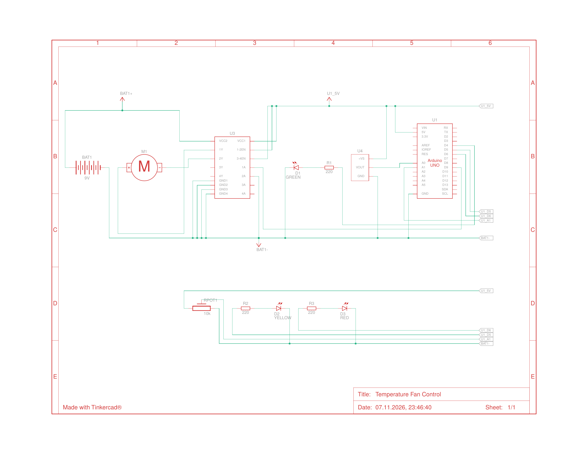

# Arduino Temperature-Based Fan Control

An Arduino system that automatically controls a DC fan based on temperature.
A TMP36 sensor measures the temperature, and an L293D motor driver controls the
fan speed with PWM. The target temperature (setpoint) is adjustable with a
potentiometer, and three LEDs show the system status.

Built and simulated in Autodesk Tinkercad as an Electronics project
at Astana IT University.

🔗 **Interactive simulation:** https://www.tinkercad.com/things/aUnJ9qgaSU9-temperature-fan-control

## Features
- **Adjustable setpoint** – a potentiometer sets the target temperature (20–35 °C)
- **Hysteresis** – the fan turns on above the setpoint and off only 2 °C below it,
  which prevents rapid on/off switching
- **Proportional control** – fan speed increases smoothly with temperature
- **Moving-average filter** – averages the last 10 readings to reduce sensor noise
- **LED status indication**
  - 🟢 Green – normal, fan off
  - 🟡 Yellow – fan running
  - 🔴 Red – overheat (setpoint + 10 °C)
- **Serial monitoring** – temperature, setpoint, fan state and speed

## What I did beyond the original tutorial
The project was inspired by a TechKnowLab tutorial with step-based fan speed.
I extended it with:
- an adjustable setpoint instead of fixed thresholds
- hysteresis and proportional speed control instead of 4 fixed speed steps
- a moving-average filter
- LED status indication and serial monitoring
- debugging the circuit: fixed a wrong PWM pin connection and incorrect resistor
  values (220 kΩ → 220 Ω) found through the schematic view

## Components
Arduino Uno · TMP36 temperature sensor · L293D motor driver · DC motor (fan) ·
9 V battery · 10 kΩ potentiometer · 3 LEDs (green, yellow, red) ·
3 × 220 Ω resistors · 2 breadboards

## Wiring
| Component | Arduino pin |
|---|---|
| TMP36 output | A0 |
| Potentiometer (wiper) | A1 |
| L293D Enable 1 (fan speed, PWM) | ~9 |
| Green LED | 4 |
| Yellow LED | ~5 |
| Red LED | ~6 |

The Arduino GND and the battery negative terminal share a common ground.

## Demo
**Circuit (Tinkercad):**

**Schematic:**

**Serial Monitor output:**

## Code
See [`fan_control.ino`](fan_control.ino).

## Skills
Arduino · Embedded C/C++ · Sensors and actuators · PWM motor control ·
Hysteresis control · Signal filtering · Circuit design and debugging

## Author
Duisengaliyeva Adel, Astana IT University (ST-2502)
